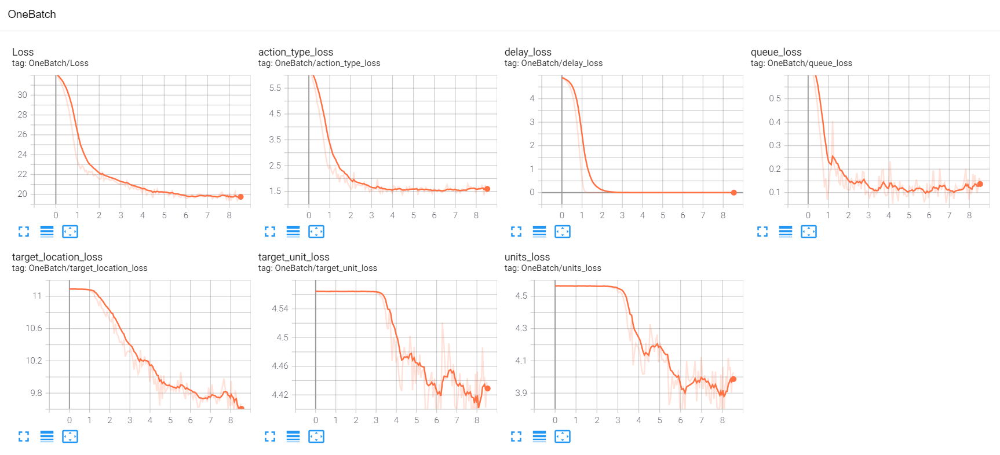

# mini-AlphaStar

## Introduction

The mini-AlphaStar (mini-AS, or mAS) project is a **mini-scale** version of the AlphaStar (AS) program. AlphaStar is the intelligent AI proposed by DeepMind to play StarCraft II. Note the mini-AS is a research project. It is not an official product of DeepMind.

The "mini-scale" means making the original AS's hyper-parameters **adjustable** so that we can train mini-AS on a **small** scale, e.g., in a single common commercial server machine.

We referred to the "Occam's Razor Principle" when designing the mini-AS: **simple** is good. Therefore, we build the mini-AS from scratch. Unless the function significantly impacts speed and performance, we shall omit it. Meanwhile, we also try not to use too many dependency packages so that mini-AS should only depend on the PyTorch. In this way, we simplify the learning cost of the mini-AS and make the architecture of mini-AS relatively **easy**. 

The [Chinese](doc/README_CHS.MD) shows a simple readme in Chinese.

> ### Branch note (2026-11): two evaluation campaigns on this branch
>
> This tree is an **evaluation branch**. It carries (a) the earlier *batch acting*
> experiment and (b) a four-day SL/RL improvement campaign. Both produced results that
> are partly positive and partly negative; both are reported as measured, not as claims.
>
> #### Part 1 — batch acting (earlier work)
>
> The performance result is **negative**. At the default production configuration
> (15 Workers x 2 actors, 3x RTX 4090), batch acting is **6.3% slower** than local
> inference: **107.03 vs 100.69 step/s**, measured over 1800 s each, with the model mode
> (`eval`) and every other knob held identical. Batching only pays off when the actor
> count is large: ~0.96x at 2 actors, ~2.55x at 24 actors.
>
> One correctness result is **positive and independent of performance**. The distillation
> term in `alphastarmini/core/rl/rl_algo.py::kl` was a *masked partial sum over the common
> support*, not a KL: it can be negative, and on `action_type` it is **23.6x larger** than
> the true KL (0.4999 vs 0.0212 on one real batch). A corrected, renormalized implementation
> is available via `MAS_KL_MODE=renorm`; the default deliberately stays `legacy` until an
> ablation decides it.
>
> #### Part 2 — SL/RL improvement campaign (2026-11-02 → 11-04)
>
> **Result in one line.** SL was raised from *"0% win rate, collects 2,676 resources"* to
> *"4.3% win rate, collects 9,010 resources (95% of the official 2021 SL model)"*.
> **It did not reach the official SL win rate (17.5%).** The RL loop was then brought up
> from "never executed" to "runs, collects trajectories, trains, and logs every loss",
> but its win rate did not move within the one-hour budget.
>
> | Stage | Model | n | Win rate (Wilson 95%) | Collected | Killed | Army |
> |---|---|---|---|---|---|---|
> | baseline | old SL (1/60 data silently) | 20 | 0.0% | 2,676 | 145 | — |
> | **SL (this branch)** | `SOUP_prior3` | **230** | **4.3% [2.4, 7.8]** | **9,010** | 1,439 | **21.2** |
> | reference | official SL `sl_21-12-29` | 80 | **17.5% [10.7, 27.3]** | 9,494 | 1,811 | 14.0 |
> | reference | official RL `rl_22-02-09` | 28 | 21.4% | 9,533 | 1,787 | — |
>
> Two reference numbers were themselves corrected during this work: the official SL win
> rate had been quoted as **7.1%** for many rounds; re-measuring the same checkpoint over
> 80 games gives **17.5% [10.7, 27.3]**. The old 7.1% was a 28-game point estimate.
> **Every "we caught up" claim made against 7.1% was therefore void** — see the errata list.
>
> **Three structural defects were found and fixed** (each one explained a symptom that had
> been mis-attributed to hyper-parameters for several rounds):
>
> 1. **Silent data down-scaling.** `SIMPLE_TEST = not P.on_server` plus
>    `replay_files[:2]` meant that forgetting one environment variable made a 2.5-hour
>    training run use **1 replay out of 60** (`train_set = 120` sequences). Fixed by making
>    smoke mode explicit (`MAS_SL_SMOKE=1`) and printing `[SL-config] files=… smoke=…` on
>    the first screen.
> 2. **Action distribution distorted by frame sampling.** The converter samples by a fixed
>    frame stride (~every 20 frames) while the agent issues one command every 8 frames, so
>    most sampled frames are labelled `no_op`: the training data is **81.0% `no_op`,
>    2.7% `Build_Pylon`, 1.1% `Train_Probe`**, while the official model plays with
>    **0% `no_op`, 29.8% `Build_Pylon`, 21.1% `Train_Probe`**. The model was a faithful
>    mirror of its data: it idled 99.9% of the time. Fixed by **action re-weighting**
>    (importance weights `w[a] = clip((target[a]/data[a])**1.0, 0.1, 50)` on the
>    `action_type` head), which brought live `no_op` from **37% to 6.7%**.
> 3. **Weight checkpoint selection by validation accuracy was inverted.** `val action acc`
>    rewards conservatism: epoch 3 had val 0.44 but idled only 50% of the time, epoch 10
>    had val 0.83 but idled 96.8%. Model selection must use **behaviour** (killed, idle
>    ratio, win rate), not action-classification accuracy.
>
> **One zero-cost trick that worked twice: weight-space averaging.** Averaging the weights
> of adjacent epochs from the same run (`experiments/_avg_models.py`) raised the kill
> ceiling from 2,550 to 6,900 and the win rate from 1.9% to 5.1% at n=158 (and 4.3% at
> n=230 after more samples). Averaging *more* snapshots (5 instead of 3) is worse: the
> aggressive epoch gets diluted.
>
> **Negative results are listed too**, because they cost the most time: more data
> (3.7x) hurt the army; training longer made the policy conservative again; attack
> re-weighting (1.5x and 3.0x), `units/location` re-weighting (10x/5x), filtering replays
> by combat density, and fine-tuning from the averaged model all failed. See
> `doc/IMPROVEMENTS_2026_11.md` §5 for the complete table and `ERRATA.md` for every claim
> that was later withdrawn.
>
> #### Part 3 — RL loop status
>
> The A3C loop (`rl_vs_inner_bot_mp`) had **never been executed** before this campaign.
> Bringing it up required six fixes (`MAS_RL_INIT_MODEL` to stop silently loading the
> wrong SL checkpoint, a configurable win-rate window, a zero-row statistics crash,
> a heartbeat, a spawn/subprocess constants mismatch, and un-gated debug prints).
> After them the loop runs and produces: **256 logged RL loss points, UPGO in
> 0.003–0.20, per-head KL ≤ 0.0014** (small because the policy starts from the SL
> weights, which is the expected signature), `winrate/every_4_episodes` scalars, and
> 9 completed episodes in 20 minutes. **Its win rate stayed 0**, which is consistent
> with a 4.3% SL policy over 9 games.
>
> **Two soak runs, two different failures — stated plainly.**
>
> * **Soak #1** (8 actors): ran 1201 s, completed **9 episodes** (8 draws, 1 loss), logged
>   256 loss points — then **died silently with no traceback**: the Python process group
>   vanished, 8 SC2 processes were orphaned, 100 GB of RAM was still free. So it was not
>   an OOM and not a Python exception.
> * **Soak #2** (6 actors): the process stayed alive for 34 minutes with 6 live SC2
>   instances, but recorded **0 episodes** — the per-episode termination was never reached
>   or never reported.
>
> **A 30–60 minute soak is therefore *not yet proven*.** What *is* proven is that the
> algorithm chain is correct: trajectories are collected, all six head losses and their KL
> terms are logged, the optimizer steps, and `winrate/*` scalars are written.
>
> A third observation invalidated part of the diagnosis itself: with `python run_rl.py >
> log/x.log`, the Python parent **and 6–8 SC2 children** write to the *same* file
> descriptor, each keeping its own offset, so they **overwrite each other**. "The heartbeat
> stopped at t = N" was therefore partly an artefact of log self-overwriting, not proof
> that a thread died. Subsequent runs must use `>>` (atomic append) or one file per process.
> This is recorded as item #53 so the next reviewer does not re-derive it.
>
> #### How this was done (human-in-the-loop, multiple agents)
>
> This campaign was run by **one human supervisor directing several LLM agents**, not by a
> single autonomous model:
>
> | Role | Who | What they actually did |
> |---|---|---|
> | Supervisor / repository owner | **Ruo-Ze Liu (`liuruoze`)** | Set the goal each round, supplied the official 2021/2022 checkpoints and the missing 30 replays, corrected wrong directions (e.g. pointed at the official model release when an agent was guessing), enforced a "reflection → plan → log" discipline, and rejected claims that were not backed by measurements |
> | Executor (this campaign) | **DeepSeek-V4.1-Flash** | Ran the experiments end-to-end: static audits, training/evaluation jobs, instrumentation, and the write-ups numbered **#23–#52** in `BATCH_ACTING_EXECUTION_LOG_DS12.md` |
> | Code review (earlier rounds) | **GLM** (#1–#22), **Kimi 3.1 Pro**, **MiniMax H3.1**, **space-bunny** | Reviewed diffs, challenged conclusions, and in several cases caught errors that the executor had already written down as conclusions (see `ERRATA.md`: 78 entries, including 5 that were withdrawn by the executor itself) |
>
> Two habits made the difference, and both came from the supervisor: **(a)** every claim must
> carry a falsifiable criterion and a measured number, and **(b)** every withdrawn claim goes
> into an errata file rather than being quietly deleted. Most of the "discoveries" in this
> branch were preceded by a wrong guess that the errata records.
>
> The working notes (30+ documents of run logs, plans, reviews and the errata list) are
> deliberately **kept out of this repository** — they contain machine-specific paths.
> Treat every number above as **one measured snapshot on one machine** (4x RTX 4090,
> 128 cores), not as a reproduced benchmark.
>
> Acceptance tests / benchmarks / soak orchestration live in **[`experiments/`](experiments/README.md)**
> and are **not** part of the library.
>
> #### Reproducing the reported SL number
>
> ```bash
> # 1) train: 20 replay files x 2 epochs, action re-weighting on, 30 replay-epochs total
> MAS_ON_SERVER=1 MAS_SL_MAX_FILES=20 MAS_SL_WORKERS=0 MAS_SL_EPOCHS=2 \
> MAS_SL_ACTION_REWEIGHT=1 MAS_SL_PRIOR_EXP=1.0 \
> CUDA_VISIBLE_DEVICES=0 python run_sl.py --path1 ./data/replay_data_v3/
>
> # 2) average the checkpoints of the same run (zero extra training)
> python experiments/_avg_models.py \
>   --a model/<run>_ep01.pth --b model/<run>_ep02.pth --more model/<other-run>_ep03.pth \
>   --out model/BEST_SL.pth
>
> # 3) evaluate, 4 shards x N games, native outcome only
> MAS_ON_SERVER=1 python experiments/_eval_winrate.py \
>   --model model/BEST_SL.pth --games-per-shard 15 --shards 4 --gpus 0,1,2,3
> ```
>
> #### Reproducing the RL loop
>
> ```bash
> # one hour, 8 actors, explicit SL initialisation, heartbeat every 60 s
> MAS_ON_SERVER=1 MAS_RL_INIT_MODEL=model/BEST_SL.pth \
> MAS_MAX_TIME=3000 MAS_ACTOR_NUMS=2 MAS_PARALLEL=4 \
> MAS_STATIC_NUM=4 MAS_HEARTBEAT_SEC=60 MAS_QUEUE_TIMEOUT=900 \
> MAS_GPU_LIST=1,2,3 CUDA_VISIBLE_DEVICES=0,1,2,3 python -u run_rl.py
> ```
>
> `MAS_RL_INIT_MODEL` is **not optional in practice**: without it the loader picks the
> lexicographically last `sl_*.pth` in `model/`, which during this campaign was a
> deliberately broken checkpoint.

Below 4 GIFs are mini-AS' trained performance on Simple64, supervised learning on 50 expert replays.

<p float="left">
  
   
</p>

**Left:** At the start of the game.     **Right:** In the middle period of the game.

<p float="left">
  
  
</p>

**Left:** The agent's 1st attack.      **Right:** The agent's 2nd Attack.

## Update

This release is the "v_1.09" version. The main changes are as follows:

* Fixed some known bugs and issues;
* Improve to a new SL setting to train a good SL model more likely;
* Change STEP_MUL to 8 to gain more good RL training results;
* Add logs for all the losses in the RL training to gain better information about the process;
* Increase the win rate against level-1 bot to 0.85 (the best so far);
* For the first time, provide the pre-trained SL model for RL training to use;
* For the first time, provide the final RL model for others to reproduce the results easily;

## Hints

**Warning**: SC2 is extremely difficult, and AlphaStar is also very complex. Though our project is a mini-AlphaStar, it has almost the similar technologies as AS, and the training resource also costs very high. We can hardly train mini-AS on a laptop. The recommended way is to use a commercial server with a GPU card plus large memory and disk space. For someone interested in this project for the first time, we recommend you collect (star) this project. Devolve deeply into researching it only when you have enough free time and training resources.

## Location

We store the codes and show videos in two places. 

Codes location | Result video location | Usage 
------------ | ------------- | -------------
[Github](https://github.com/liuruoze/mini-AlphaStar) | [Youtube](https://youtu.be/mTtA0vdAULw) | for global users 
[Gitee](https://gitee.com/liuruoze/mini-AlphaStar) | [Bilibili](https://www.bilibili.com/video/BV1Hm4y197Jm/) | for users in China 

## Contents

The table below shows the corresponding packages in the project.

Packages | Content
------------ | -------------
alphastarmini.core.arch | deep neural architecture
alphastarmini.core.sl | supervised learning
alphastarmini.core.rl | reinforcement learning
alphastarmini.core.ma | multi-agent league traning
alphastarmini.lib | lib functions
alphastarmini.third | third party functions

## Requirements

PyTorch >= 1.5, others please see requirements.txt.

## Install

The [SCRIPT Guide](scripts/Setup_cmd.MD) gives some commands to install PyTorch by conda (this will automatically install CUDA and cudnn, which is convenient).

E.g., like (to install PyTorch 1.5 with accompanied CUDA and cudnn):
```
conda create -n th_1_5 python=3.7 pytorch=1.5 -c pytorch
```

Next, activate the conda environment, like:
```
conda activate th_1_5
```

Then you can install other python packages by pip, e.g., the command in the below line:
```
pip install -r requirements.txt
```

## Usage

After you have done all requirements, run the below python file to run the program:
```
python run.py
```
You may use comments and uncomments in "run.py" to select the training process you want.

The [USAGE Guide](doc/USAGE.MD) provides answers to some problems and questions.

You should follow the following instructions to get similar or better results than the provided gifs on the main page.

We summarised the usage sequences as the following:

1. Transform replays: download the replays for training, then use the script in mAS to transform the replays to trainable data;
2. Supervised learning: use the trainable data to supervise learning an initial model;
3. Evaluate SL model: the trained SL model should be evaluated on the RL environment to make sure it behaves right;
3. Reinforcement learning: use the trained SL model to do reinforcement learning in the SC environment, seeing the win rate starts growing.

We give detailed descriptions below.

## Transofrm replays

In supervised learning, you first need to download SC2 replays.

The [REPLAY Guide](doc/REPLAY.MD) shows a guide to download these SC2 replays.

The [ZHIHU Guide](https://zhuanlan.zhihu.com/p/410523216) provides Chinese users who are not convenient to use Battle.net (outside China) a guide to download replays.

After downloading replays, you should move the replays to "./data/Replays/filtered_replays_1" (you can change the name in `transform_replay_data.py`).

Then use `transform_replay_data.py` to transform these replays to pickles or tensors (you can change the output type in the code of that file).

You don't need to run the transform_replay_data.py directly. Only run "run.py" is OK. Make the run.py has the following code

```
    # from alphastarmini.core.sl import transform_replay_data
    # transform_replay_data.test(on_server=P.on_server)
```

uncommented. Then you can directly run "run.py".

**Note**: To get the effect of the trained agent in the gifs, use the replays in [Useful-Big-Resources](https://github.com/liuruoze/Useful-Big-Resources/blob/main/replays). These replays are generatedy by our experts, to get an agent having the ability to win the built-in bot.

## Supervised learning

After getting the trainable data (we recommend using tensor dat). Make the run.py has the following code

```
    # from alphastarmini.core.sl import sl_train_by_tensor
    # sl_train_by_tensor.test(on_server=P.on_server)
```

uncommented. Then you can directly run "run.py" to do supervised learning.

The default learning rate is 1e-4, and the training epochs should best be 10 (more epochs may cause the training effect overfitting).

From the v_1.05 version, we support multi-GPU supervised learning (not recommended now) training for mini-AS, improving the training speed. The way to use multi-GPU training is straightforward, as follows:
```
python run_multi-gpu.py
```

Multi-GPU training has some unstable factors (caused because of PyTorch). If you find your multi-GPU training has training instability errors, please switch to the single-GPU training.

We currently support four types of supervised training, which all reside in the "alphastarmini.core.sl" package.

File | Content
------------ | -------------
`sl_train_by_pickle.py` | pickle (data not preprocessed) training: Slow, but need small disk space.
`sl_train_by_tensor.py` | tensor (data preprocessed) training: Fast, but cost colossal disk space.
`sl_multi_gpu_by_pickle.py` | multi-GPU, pickle training: It has a requirement need for large shared memory.
`sl_multi_gpu_by_tensor.py` | multi-GPU, tensor training: It needs both large memory and large shared memory.

You can use the `load_pickle.py` to transform the generated pickles (in "./data/replay_data") to tensors (in "./data/replay_data_tensor").

From the v_1.06 version, we still recommend using single-GPU training. 

The newest training ways (e.g., in v_1.07) are still in the single GPU type due to multi-GPU training cost too much memory.

## Evaluate SL model

After getting the supervised learning model, we should test the model's performance in the SC2 environment. The reason is that there is a domain shift from the SL data to the RL environment. 

Make the run.py has the following code

```
    # from alphastarmini.core.rl import rl_eval_sl
    # rl_eval_sl.test(on_server=P.on_server)
```

uncommented. Then you can directly run "run.py" to do an evaluation of the SL model.

The evaluation is similar to RL training, but the updating is closed. The running is also in single-thread, to make the randomness due to multi-thread not affect the evaluation.

## Reinforcement learning

After ensuring the supervised learning model is OK and suitable for RL training, we can do RL based on the learned supervised learning model. 

Make the run.py has the following code

```
    # from alphastarmini.core.rl import rl_vs_inner_bot_mp
    # rl_vs_inner_bot_mp.test(on_server=P.on_server, replay_path=P.replay_path)
```

uncommented. Then you can directly run "run.py" to do reinforcement learning.

Note RL training uses a multi-process plus multi-thread manner (to accelerate the learning speed), so make sure to run these codes on a high-performance computer. 

E.g., we run 15 processes, and each has two actor threads and one learner thread. If your computer is not strong, reduce the parallel nums.

The learning rate should be low (below 1e-5 because you are training on an initially trained model). The training iterations should be as long as best (more training iterations can reduce the instability of RL training).

If you find the training result is not good as you imagine, please open an issue to ask us or discuss with us (though we can not make sure to respond to it in time or there is any solution to every problem).

## Pre-trained Models

You can find the pre-trained models [here](https://github.com/liuruoze/Useful-Big-Resources/blob/main/mAS-models).

The "sl_21-12-29_08-15-43.pth" is the supervised learning pre-trained model by our method. 

The "rl_22-02-07_16-26-48.pth" is the reinforcement learning trained model by our method based on the previous model.

The "rl_22-02-09_19-16-39.pth" is the reinforcement learning (more time) final model by our method based on the previous supervised learning model.

## Results

Here are some illustration figures of the SL training process below:



We can see the loss (one primary loss and six argument losses) fall quickly.

We provide more curves (like the accuracy curve) for the SL training process after the v_1.05 version.

The trained behavior of the agents shows in the gifs on this page.

Our later paper will provide a more detailed illustration of the experiments (such as the effects of different hyper-parameters).

## History

The [HISTORY](doc/HISTORY.MD) is the historical introduction of the previous versions of mini-AS.

## Citing

If you find our repository useful, please cite our project or the below technical report:
```
@misc{liu2021mAS,
  author = {Ruo{-}Ze Liu and Wenhai Wang and Yang Yu and Tong Lu},
  title = {mini-AlphaStar},
  year = {2021},
  publisher = {GitHub},
  journal = {GitHub repository},
  howpublished = {\url{https://github.com/liuruoze/mini-AlphaStar}},
}
```

The [An Introduction of mini-AlphaStar](https://arxiv.org/abs/2104.06890) is a technical report introducing the mini-AS (not full version).
```
@article{liu2021mASreport,
  author    = {Ruo{-}Ze Liu and
               Wenhai Wang and
               Yanjie Shen and
               Zhiqi Li and
               Yang Yu and
               Tong Lu},
  title     = {An Introduction of mini-AlphaStar},
  journal   = {CoRR},
  volume    = {abs/2104.06890},
  year      = {2021},
}
```

## Rethinking

The [Rethinking of AlphaStar](https://arxiv.org/abs/2108.03452) is our thinking of the advantages and disadvantages of AlphaStar.


## Paper

We present detailed experiments and evaluations using the mini-AS in this [paper](https://arxiv.org/abs/2209.11553). 