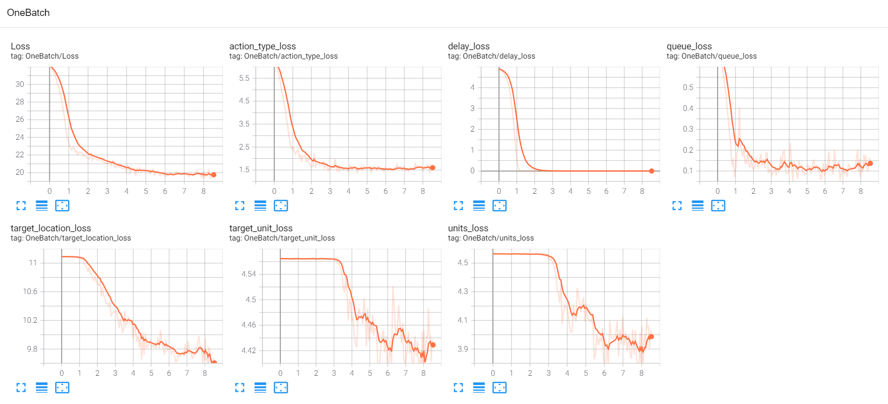

# mini-AlphaStar

**English** | [中文](doc/README_CHS.MD)

## Introduction

The mini-AlphaStar (mini-AS, or mAS) project is a **mini-scale** version of the AlphaStar (AS) program. AlphaStar is the intelligent AI proposed by DeepMind to play StarCraft II. Note the mini-AS is a research project. It is not an official product of DeepMind.

The "mini-scale" means making the original AS's hyper-parameters **adjustable** so that we can train mini-AS on a **small** scale, e.g., in a single common commercial server machine.

We referred to the "Occam's Razor Principle" when designing the mini-AS: **simple** is good. Therefore, we build the mini-AS from scratch. Unless the function significantly impacts speed and performance, we shall omit it. Meanwhile, we also try not to use too many dependency packages so that mini-AS should only depend on the PyTorch. In this way, we simplify the learning cost of the mini-AS and make the architecture of mini-AS relatively **easy**. 

The [Chinese README](doc/README_CHS.MD) mirrors this file section by section. Both start with a
language switch, so neither is a dead end.

## Demo

These GIFs show mini-AS on Simple64 after supervised learning on 50 expert replays. They come from
the v_1.09 era rather than the model in the update below; they are here to show what mini-AS looks
like in play.

<p float="left">
  
   
</p>

**Left:** At the start of the game.     **Right:** In the middle period of the game.

<p float="left">
  
  
</p>

**Left:** The agent's 1st attack.      **Right:** The agent's 2nd Attack.

## Update

This is the change note for this push, limited to supervised learning (SL): the score, how the
model was trained, and the one thing that differs from v_1.09. Reinforcement learning is untouched
and has no usable model yet, so it stays out.

The change sits in the training data: 5 human replays are mixed into the machine data. Architecture,
hyper-parameters and evaluation are untouched, and the score goes from 31.2% to 45.6%, 14.4
points up.

Suggested reading order: the summary table first, then the method (DAgger and the rule expert), then
the training settings and the commands.

The full record is in [IMPROVEMENTS_2026_11.md](doc/IMPROVEMENTS_2026_11.md), the conclusions and
the evaluation gates are in [CONCLUSIONS.md](docs/exp/CONCLUSIONS.md), and the naming rules are in
[NAMING.md](docs/exp/NAMING.md).

Two definitions first, or the table will not make sense. A strict win means `raw_reward == +1`, and
games that stop at the step cap do not count; that is the number we normally quote. A lenient win
means `outcome == 1`, or `outcome == 0` with `killed_points > 4000`, and it exists so numbers can be
lined up with the 2021 documents and older records. Also, only rows with the same condition can be
compared: different difficulty, step count or seed count means the numbers cannot be subtracted.

First, the result. The table lines up five objects: the weight released together with v_1.09, B0
retrained with the new code, the two recipes, and the best weight of this round. Every row carries
its own condition.

Two terms recur below. A recipe is one fixed combination of data, hyper-parameters and training
procedure; running the same recipe with another seed gives one run. The game count is how many games
were played under that condition.

Object | Training data | Condition | Games | Strict win | Lenient win | Note
------------ | ------------- | ------------- | ------------- | ------------- | ------------- | -------------
v_1.09 release weight | 90 human replays (2021) | D1 / 40k | 20 | 15% | 40% | left-top 7/8 = 88%, matching its documented 0.85
same | same | D2 / 40k | 10 | 0% | 20% | both lenient wins stop at the step cap
same | same | D3 / 40k | 20 | 0% | 0% | 55-61 supply at 9 minutes, overrun by the first push
`Base` (B0) | the same 90 replays, retrained with the 2026 code | 30k / seed 3038 only | 4 | 0% | 25% | 4 games on seed 3038 only, from different snapshots, not a recipe score
`ExpertGuided` (self-play plus rule-expert data) | 30 self-play + 30 rule-expert replays (DAgger) | D3 / 40k | 80 | 31.2% | 62.5% (40 games; that run's strict win is 42.5%) | 4 runs pooled; lenient can only be computed on the single run `cwB_ep4`
`HumanHybrid` (that data plus human replays) | the same + 5 human replays | D3 / 40k | 316 | 45.6% | 51.1% (180 games) | 15 runs pooled, Wilson [40.2, 51.1]; lenient computed on the 6 no_op-only runs, whose strict score is also 45.6%
`HumanHybrid`, best weight | the same | D3 / 40k | 39 | 64.1% | 66.7% | selection bias, an asset rather than a recipe score

Two things need a word. First, the two lenient cells come from the subset whose raw output is still
on disk, with the game count in brackets; they are not the same games as the full strict totals
(316 and 80).

Second, only the difficulty 3 rows can be compared directly. On that row v_1.09 is 0/20,
`ExpertGuided` is 31.2% and `HumanHybrid` is 45.6%.

Where does the result come from? The base is built with DAgger, 5 human replays are mixed in, and
the network is trained with the settings at the end of this section. The rest of the section takes
those steps apart.

DAgger comes first, because the data composition rests on it. DAgger is short for Dataset
Aggregation. Plain supervised learning only sees the states the expert visited, so once the model
plays on its own it drifts into states it has never seen and the error compounds. DAgger lets the
current policy run, collects the states it actually reaches, asks the expert to label the actions
there, and aggregates that new data into the training set. Repeat for a few rounds and the training
distribution moves towards the one at inference time.

DAgger needs an expert. Here it is not a human but the rule expert v5
(`experiments/_rule_expert_v5.py`).

Its implementation has two parts: how it decides every frame, and how it picks a build site. It is
plain Python with numpy as its only dependency and no learning framework; it reads the raw
observation the game gives and emits raw actions, which is what lets it run inside the DAgger
collector.

The decision part walks a fixed priority. Every frame it calls `summarize()` to work out minerals,
gas, supply, supply cap and idleness, then picks one action: supply, first Pylon, probes, gateways,
units, defence, attack, mining.

The placement part does not use hard-coded coordinates. It checks the whole building footprint
against SC2's `placement_grid`, and a Protoss building must also sit inside a Pylon power field, on
the same height level, on explored ground and clear of mineral patches. A site that has already been
ordered goes on cooldown and a blacklist, so a rejected command is not re-sent every frame.

One more piece exists for dataset quality. So that 30 games are not the same game, each one draws a
strategy from its seed (fast rush, two gate, heavy gate, macro, harass, turtle, late), and the probe
count, gateway count and attack threshold jitter within a range.

Back to this round's data. Textbooks iterate DAgger, resampling with the current policy every
round; we ran round 1 only: 30 bot self-play games give 21,983 frames, 30 games played by the rule
expert give 9,578 expert frames, and the two sets are aggregated into 31,561 frames.

The expert frames drop `Cancel_Last_quick`, which is 8.5% of them and otherwise teaches the model a
cancel-and-reissue loop. Training has to run with `MAS_DAGGER=1`; without the flag the trainer
refuses to start, so DAgger data cannot be trained as if it were ordinary data.

### The five versions of the rule expert

Why does this deserve its own table? Because the strength of the expert sets the quality of the
expert frames, and those frames are the ceiling of DAgger. From v1 to v5 the changes sit in two
places: how the decision layer picks an action, and how the placement layer picks a build site.

The last column holds whatever that version could actually measure: a win rate once it could play,
a build-site dedup rate before that. So the 0.086 and 0.018 in the v1 and v2 rows are dedup rates,
not win rates.

Version | Play style | Decisions | Randomisation | In a real game
------------ | ------------- | ------------- | ------------- | -------------
v1 | minimal intervention, acting only on a clear gap | takes a hand-built summary (supply, cap, probes, Pylons, gateways, army, minerals) and defines 5 actions: Pylon, gateway, stalker, zealot, attack; build sites come from a fixed template in the collector | none | in practice only 1-2 of them ever fire, degenerating into a Pylon loop; build-site dedup rate 0.086
v2 | same as v1, plus dynamic placement | the decision logic stays v1; adds `LocationPicker`: anchor at the Nexus (19,23), ring candidates at radius 4-12, avoid tiles occupied within 2, rotate by tick | none | interface and self-test only, never wired into the collector; the dedup rate in the data is still 0.018
v3 | follows PiGBot's B2GM opening table, by default 2-Gate Expand on one base | step through the table: supply, build order, probes, units, fallback Pylon, attack; placement uses the terrain height map and the Pylon power field | none | stuck on the assimilator step, 6,000 steps with no intervention; build failures fall from 89.8% to 6-7%, but difficulty 3 is still 0/5
v4 | drops the table for a pure Zealot rush | acts every frame: supply and first Pylon, probes, gateways, units, defence, attack, mining; pulls back when the enemy is within 8 tiles; cancels the learner's queued probes to free minerals | each game draws a strategy from its seed (fast rush, two gate, heavy gate, macro, harass, turtle, late), with probe count, gateway count and attack threshold jittering inside a range | the goal is to beat difficulty 1 on its own with the learner doing nothing
v5 | same as v4 | same as v4 | same as v4, only the fast-rush branch is retuned: 15-18 probes, 3 gateways, attack threshold 9-12, no retreat refresh; the Zealot hold window goes from 6-9 frames to 3-6 | the current default (`MAS_EXPERT_IMPL=v5`); the expert frames here come from it

This round uses v5: its code is almost the same as v4, only the fast-rush branch was retuned.

With the base built, the second step is to mix in human data. We take 5 replays from the
2021-11-21 batch, 4,545 frames, 12.6% of all training frames. Of those, 4,247 are `no_op` frames
where the human does nothing and 298 are action frames. Keeping only the `no_op` frames (4,247,
11.86%) scores the same, so that part is what does the work.

Training settings come last. They are identical to the previous `ExpertGuided`; only the data
changed, so there is nothing to compare back and forth below.

Item | Value
------------ | -------------
architecture | the one in v_1.09, 128 entities
trainer | `run_sl.py -p1`
epochs | 4
learning rate | 1e-3
gamma | 0.2
step size | 3
batch | 24
sequence length | 4
train / validation split | by game, 60 files for training and 5 for validation
class weights | `train_probe` 0.15, `build_pylon` 8, `build_gateway` 8, `build_nexus` 0.1, `train_zealot` 4
runs | 15 seeds, about 31 minutes each, score pooled over every game of every run

How do we know those frames are what did it? A control: keeping only the action frames of the same
5 replays does nothing, 32.4% over 179 games, which is the 31.2% baseline.

To reproduce it, two steps. First, train one run:

```bash
DATA=$PWD/data/replay_data_a3nc_h5 MAS_ON_SERVER=1 MAS_DAGGER=1 \
MAS_SL_LR=1e-3 MAS_SL_EPOCHS=4 \
MAS_SL_CLASS_WEIGHTS="train_probe=0.15,build_pylon=8,build_gateway=8,build_nexus=0.1,train_zealot=4" \
  bash experiments/train_bvb_m30.sh <tag> 4 <seed> <gpu>
```

Second, evaluate the 20 standard seeds:

```bash
OFF_DIFFICULTY=3 OFF_GAME_STEPS=40000 \
  bash experiments/run_p8_eval.sh <tag> $(seq 3038 3057)
```

One pitfall to flag. `MAS_RL_INIT_MODEL` is required: without it the loader takes the
lexicographically last `sl_*.pth` in `model/`, which during this work was a deliberately broken
checkpoint.

## Version

This release is the "v_1.09" version. The main changes are as follows:

* Fixed some known bugs and issues;
* Improve to a new SL setting to train a good SL model more likely;
* Change STEP_MUL to 8 to gain more good RL training results;
* Add logs for all the losses in the RL training to gain better information about the process;
* Increase the win rate against level-1 bot to 0.85 (the best so far);
* For the first time, provide the pre-trained SL model for RL training to use;
* For the first time, provide the final RL model for others to reproduce the results easily;

## Hints

**Warning**: SC2 is extremely difficult, and AlphaStar is also very complex. Though our project is a mini-AlphaStar, it has almost the similar technologies as AS, and the training resource also costs very high. We can hardly train mini-AS on a laptop. The recommended way is to use a commercial server with a GPU card plus large memory and disk space. For someone interested in this project for the first time, we recommend you collect (star) this project. Devolve deeply into researching it only when you have enough free time and training resources.

## Location

We store the codes and show videos in two places. 

Codes location | Result video location | Usage 
------------ | ------------- | -------------
[Github](https://github.com/liuruoze/mini-AlphaStar) | [Youtube](https://youtu.be/mTtA0vdAULw) | for global users 
[Gitee](https://gitee.com/liuruoze/mini-AlphaStar) | [Bilibili](https://www.bilibili.com/video/BV1Hm4y197Jm/) | for users in China 

## Contents

The table below shows the corresponding packages in the project.

Packages | Content
------------ | -------------
alphastarmini.core.arch | deep neural architecture
alphastarmini.core.sl | supervised learning
alphastarmini.core.rl | reinforcement learning
alphastarmini.core.ma | multi-agent league traning
alphastarmini.lib | lib functions
alphastarmini.third | third party functions

## Requirements

PyTorch >= 1.5, others please see requirements.txt.

## Install

The [SCRIPT Guide](scripts/Setup_cmd.MD) gives some commands to install PyTorch by conda (this will automatically install CUDA and cudnn, which is convenient).

E.g., like (to install PyTorch 1.5 with accompanied CUDA and cudnn):
```
conda create -n th_1_5 python=3.7 pytorch=1.5 -c pytorch
```

Next, activate the conda environment, like:
```
conda activate th_1_5
```

Then you can install other python packages by pip, e.g., the command in the below line:
```
pip install -r requirements.txt
```

## Usage

After you have done all requirements, run the below python file to run the program:
```
python run.py
```
You may use comments and uncomments in "run.py" to select the training process you want.

The [USAGE Guide](doc/USAGE.MD) provides answers to some problems and questions.

You should follow the following instructions to get similar or better results than the provided gifs on the main page.

We summarised the usage sequences as the following:

1. Transform replays: download the replays for training, then use the script in mAS to transform the replays to trainable data;
2. Supervised learning: use the trainable data to supervise learning an initial model;
3. Evaluate SL model: the trained SL model should be evaluated on the RL environment to make sure it behaves right;
3. Reinforcement learning: use the trained SL model to do reinforcement learning in the SC environment, seeing the win rate starts growing.

We give detailed descriptions below.

## Transofrm replays

In supervised learning, you first need to download SC2 replays.

The [REPLAY Guide](doc/REPLAY.MD) shows a guide to download these SC2 replays.

The [ZHIHU Guide](https://zhuanlan.zhihu.com/p/410523216) provides Chinese users who are not convenient to use Battle.net (outside China) a guide to download replays.

After downloading replays, you should move the replays to "./data/Replays/filtered_replays_1" (you can change the name in `transform_replay_data.py`).

Then use `transform_replay_data.py` to transform these replays to pickles or tensors (you can change the output type in the code of that file).

You don't need to run the transform_replay_data.py directly. Only run "run.py" is OK. Make the run.py has the following code

```
    # from alphastarmini.core.sl import transform_replay_data
    # transform_replay_data.test(on_server=P.on_server)
```

uncommented. Then you can directly run "run.py".

**Note**: To get the effect of the trained agent in the gifs, use the replays in [Useful-Big-Resources](https://github.com/liuruoze/Useful-Big-Resources/blob/main/replays). These replays are generatedy by our experts, to get an agent having the ability to win the built-in bot.

## Supervised learning

After getting the trainable data (we recommend using tensor dat). Make the run.py has the following code

```
    # from alphastarmini.core.sl import sl_train_by_tensor
    # sl_train_by_tensor.test(on_server=P.on_server)
```

uncommented. Then you can directly run "run.py" to do supervised learning.

The default learning rate is 1e-4, and the training epochs should best be 10 (more epochs may cause the training effect overfitting).

From the v_1.05 version, we support multi-GPU supervised learning (not recommended now) training for mini-AS, improving the training speed. The way to use multi-GPU training is straightforward, as follows:
```
python run_multi-gpu.py
```

Multi-GPU training has some unstable factors (caused because of PyTorch). If you find your multi-GPU training has training instability errors, please switch to the single-GPU training.

We currently support four types of supervised training, which all reside in the "alphastarmini.core.sl" package.

File | Content
------------ | -------------
`sl_train_by_pickle.py` | pickle (data not preprocessed) training: Slow, but need small disk space.
`sl_train_by_tensor.py` | tensor (data preprocessed) training: Fast, but cost colossal disk space.
`sl_multi_gpu_by_pickle.py` | multi-GPU, pickle training: It has a requirement need for large shared memory.
`sl_multi_gpu_by_tensor.py` | multi-GPU, tensor training: It needs both large memory and large shared memory.

You can use the `load_pickle.py` to transform the generated pickles (in "./data/replay_data") to tensors (in "./data/replay_data_tensor").

From the v_1.06 version, we still recommend using single-GPU training. 

The newest training ways (e.g., in v_1.07) are still in the single GPU type due to multi-GPU training cost too much memory.

## Evaluate SL model

After getting the supervised learning model, we should test the model's performance in the SC2 environment. The reason is that there is a domain shift from the SL data to the RL environment. 

Make the run.py has the following code

```
    # from alphastarmini.core.rl import rl_eval_sl
    # rl_eval_sl.test(on_server=P.on_server)
```

uncommented. Then you can directly run "run.py" to do an evaluation of the SL model.

The evaluation is similar to RL training, but the updating is closed. The running is also in single-thread, to make the randomness due to multi-thread not affect the evaluation.

## Reinforcement learning

After ensuring the supervised learning model is OK and suitable for RL training, we can do RL based on the learned supervised learning model. 

Make the run.py has the following code

```
    # from alphastarmini.core.rl import rl_vs_inner_bot_mp
    # rl_vs_inner_bot_mp.test(on_server=P.on_server, replay_path=P.replay_path)
```

uncommented. Then you can directly run "run.py" to do reinforcement learning.

Note RL training uses a multi-process plus multi-thread manner (to accelerate the learning speed), so make sure to run these codes on a high-performance computer. 

E.g., we run 15 processes, and each has two actor threads and one learner thread. If your computer is not strong, reduce the parallel nums.

The learning rate should be low (below 1e-5 because you are training on an initially trained model). The training iterations should be as long as best (more training iterations can reduce the instability of RL training).

If you find the training result is not good as you imagine, please open an issue to ask us or discuss with us (though we can not make sure to respond to it in time or there is any solution to every problem).

## Pre-trained Models

You can find the pre-trained models [here](https://github.com/liuruoze/Useful-Big-Resources/blob/main/mAS-models).

The "sl_21-12-29_08-15-43.pth" is the supervised learning pre-trained model by our method. 

The "rl_22-02-07_16-26-48.pth" is the reinforcement learning trained model by our method based on the previous model.

The "rl_22-02-09_19-16-39.pth" is the reinforcement learning (more time) final model by our method based on the previous supervised learning model.

## Results

Here are some illustration figures of the SL training process below:



We can see the loss (one primary loss and six argument losses) fall quickly.

We provide more curves (like the accuracy curve) for the SL training process after the v_1.05 version.

The trained behavior of the agents shows in the gifs on this page.

Our later paper will provide a more detailed illustration of the experiments (such as the effects of different hyper-parameters).

## History

The [HISTORY](doc/HISTORY.MD) is the historical introduction of the previous versions of mini-AS.

## Citing

If you find our repository useful, please cite our project or the below technical report:
```
@misc{liu2021mAS,
  author = {Ruo{-}Ze Liu and Wenhai Wang and Yang Yu and Tong Lu},
  title = {mini-AlphaStar},
  year = {2021},
  publisher = {GitHub},
  journal = {GitHub repository},
  howpublished = {\url{https://github.com/liuruoze/mini-AlphaStar}},
}
```

The [An Introduction of mini-AlphaStar](https://arxiv.org/abs/2104.06890) is a technical report introducing the mini-AS (not full version).
```
@article{liu2021mASreport,
  author    = {Ruo{-}Ze Liu and
               Wenhai Wang and
               Yanjie Shen and
               Zhiqi Li and
               Yang Yu and
               Tong Lu},
  title     = {An Introduction of mini-AlphaStar},
  journal   = {CoRR},
  volume    = {abs/2104.06890},
  year      = {2021},
}
```

## Rethinking

The [Rethinking of AlphaStar](https://arxiv.org/abs/2108.03452) is our thinking of the advantages and disadvantages of AlphaStar.

## Paper

We present detailed experiments and evaluations using the mini-AS in this [paper](https://arxiv.org/abs/2209.11553). 