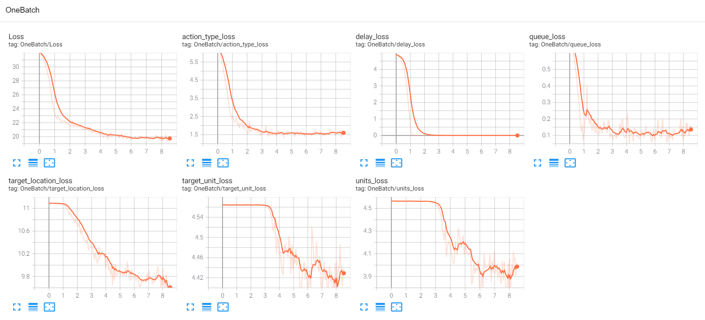

# mini-AlphaStar
> **Abstract (English).** This is the Chinese mirror of [`README.MD`](../README.MD): section order,
> commands and numbers are identical. mini-AlphaStar is a mini-scale re-implementation of AlphaStar
> with adjustable hyper-parameters, trainable on one commercial server.
> On this branch supervised learning reaches **4.3% strict wins over 230 games** while collecting
> 9,010 resources per game; the RL loop runs 25 minutes cleanly but its win rate does not move;
> the early negative result of batch acting came from the notification path, not from batching.
> Latest results: [`docs/exp/CONCLUSIONS.md`](../docs/exp/CONCLUSIONS.md).

> 本文件是 [`README.MD`](../README.MD) 的**中文镜像**：章节顺序、命令、文件名与数字与英文版一一对应。
> 发现差异按缺陷处理，改动时请两边同时改。

## 介绍

我们发布了 mini-AlphaStar 项目（v_0.X 版），它是 DeepMind 原始 AlphaStar 程序的微型复现版本。

"v_0.X" 表示我们认为已经实现了 X * 10％ 以上的代码。

"mini" 意味着我们使原始的 AlphaStar 超参数可调且微小化，以便可以小规模地运行。

在设计 mAS 时，我们参考了"奥卡姆剃刀原则"，简单就是好的。

因此我们从零开始构建 mAS，除非对速度和性能影响很大的功能，能够不加就不加。

同时也尽可能不要使用过多的依赖包，让 mAS 最好只依赖于 PyTorch（最多指定最低的版本）。

通过这样的方式，我们大大简化了 mAS 的学习成本，让 mAS 的架构和代码读起来相对容易。

另外，在代码中我们还添加了很多的注释，确保一些关键的设计能够传达给读者。

### 分支说明（2026-11）：本分支上的两次评估

> 本分支是**评估分支**，包含 (a) 早前的 *batch acting*（中心批推理）实验，
> (b) 为期四天的 SL / RL 改进。两次的结论都是**有好有坏**，下面按实测写，不按期望写。
>
> 完整记录见 [`doc/IMPROVEMENTS_2026_11.md`](IMPROVEMENTS_2026_11.md)；
> 最新结论（含 2026-11-16 的结果）见 [`docs/exp/CONCLUSIONS.md`](../docs/exp/CONCLUSIONS.md)。

#### Part 1 — batch acting（早前工作）

**2026-11-05 更正（见 `doc/batch_acting/ERRATA.md` A1/A2/A18）。** 此处最初公布的数字测于通知路径修复之前，
且其中一个被错记到了错误的 actor 数上。当前的表述是：

- **吞吐。** 在*原始*的每轮通知开销（11 ms/轮）下，批推理在默认生产配置
  （15 个 Worker × 2 个 actor、3× RTX 4090）比本地推理**慢 6.3%**：1800 秒内 107.03 对 100.69 step/s。
  把通知路径换掉（`MAS_NOTIFY=sem`）后**符号翻转**：批 **119** 对本地 **107** step/s（+11%）。
  那个负结果是通知路径的产物，不是批处理本身的性质。
- **扩展性。** 批处理只在 actor 数很大时才划算：**2 个 actor 时约 0.96x**（无收益）。
  **336 step/s** 属于 **48 个 actor、batch = 21.10**，不属于 24 个 actor（24 个 actor 测到 207 与 228 step/s）。
  常被引用的 **2.55x 是 336 / 132** —— 48 个 actor 对更早的四卡 48-actor 基线的系统级比较，
  **不是** 24 个 actor 下的受控"本地 vs 批"比值。两者都已在 ERRATA A1/A2 撤回。
- **保留意见。** 即便是更正后的 119 对 107，也只是各 30 分钟的单对（每臂 n=1，非 ABBA），
  只能当方向性参考。

一条**正确性**结果是正面的，且与性能无关。`alphastarmini/core/rl/rl_algo.py::kl` 里的蒸馏项
是*在公共支撑集上的掩蔽部分和*，不是 KL：它可以为负，且在 `action_type` 上比真 KL **大 23.6 倍**
（一个真实批上 0.4999 对 0.0212）。已提供重新归一化的正确实现（`MAS_KL_MODE=renorm`）；
默认仍**有意**保持 `legacy`，等消融实验决定。

#### Part 2 — SL/RL 改进（2026-11-02 → 11-04）

**一句话结果。** SL 从"0% 胜率、每局采集 2,676 资源"提到
"4.3% 胜率、每局采集 9,010 资源（官方 2021 SL 模型的 95%）"。
**它没有达到当时测得的官方 SL 胜率（17.5%，已作废）。** RL 主循环则从"从未执行"
做到"能跑、能采轨迹、能训练、能记录每个损失"，但胜率在一小时的预算内没有变化。

⚠️ **下面的 17.5% 参照已作废**（见 `ERRATA.md` A56 / J45）。那次 80 局跑在 native/custom 胜负拆分之前，
它的 14 个"胜"**全部**是 `killed_points > 4,000` 的改判——其中 11 局正好停在 20,992 步上限——
所以真实胜场是 **≤ 3/80 = 3.75%**。它的 **12 个负局是真的**（15.0%）。
用当前日志格式对同一 checkpoint 干净重跑（`official3036`，36 局，种子 **5000–5035**）得到
**5.6% [1.5, 18.1]，其中 86.1% 平局、8.3% 负**。以这个锚点看，本分支的 SL 模型
（4.3%，n=230）**是同级，而不是落后 9 倍**。

| 阶段 | 模型 | n | 胜率（Wilson 95%） | 采集 | 击杀 | 军队 |
|---|---|---|---|---|---|---|
| 起点 | 旧 SL（静默只用 1/60 数据） | 20 | 0.0% | 2,676 | 145 | — |
| **SL（本分支）** | `SOUP_prior3` | **230** | **4.3% [2.4, 7.8]** | **9,010** | 1,439 | **21.2** |
| 参照 | 官方 SL `sl_21-12-29`（旧跑，**已作废**） | 80 | ~~17.5%~~ → **≤3.75%** | 9,494 | 1,811 | 14.0 |
| 参照 | 官方 SL `sl_21-12-29`（**干净重跑**，`official3036`） | 36 | **5.6% [1.5, 18.1]** | — | 2,326 | 15.6 |
| 参照 | 官方 RL `rl_22-02-09` | 28 | 21.4% | 9,533 | 1,787 | — |

官方 SL 的数字曾长期被引用为 **7.1%**，后来用 80 局"修正"为 **17.5% [10.7, 27.3]**。
**那次修正现在也被撤回**：那份 80 局日志里没有 `custom_outcome` 字段，说明它早于
"把 native 与改判结果拆开"的那次修复——它打印成 `native_outcome` 的字段，
其实在 `killed_points > 4,000` 时已被改写成 1。证据是一维且精确的：
14 个"胜"的 `killed_points` 全部落在 **[4,625, 8,650]**，而 54 个平局全部 ≤ 2,975——
**中间什么都没有**，4,000 这个阈值正好落在空档里。**所以针对 7.1% 或 17.5% 得出的
"我们追上了 / 我们落后 9 倍"两类说法全部作废**——见 `ERRATA.md` A56/J45
与本地工作笔记（不随本仓库发布，见下文说明）。

**找到并修掉了三处结构性缺陷**（每一处都解释了一个被误归因为超参、且连续误判好几轮的现象）：

1. **数据被静默降级。** `SIMPLE_TEST = not P.on_server` 加上 `replay_files[:2]`，意味着
   忘记设一个环境变量，就会让 2.5 小时的训练只用到 **60 个回放里的 1 个**
   （`train_set = 120` 条序列）。修法是让冒烟模式必须显式开启（`MAS_SL_SMOKE=1`），
   并在首屏打印 `[SL-config] files=… smoke=…`。
2. **动作分布被帧采样扭曲。** 转换脚本按固定帧步长采样（约每 20 帧取一帧），
   而智能体每 8 帧才下一条命令，于是大多数被采样的帧标签是 `no_op`：
   训练数据是 **81.0% `no_op`、2.7% `Build_Pylon`、1.1% `Train_Probe`**，
   而官方模型实战是 **0% `no_op`、29.8% `Build_Pylon`、21.1% `Train_Probe`**。
   模型是数据的忠实镜像：它 **99.9%** 的时间在发呆。修法是**动作配重**
   （对 `action_type` 头做重要性加权 `w[a] = clip((target[a]/data[a])**1.0, 0.1, 50)`），
   实战 `no_op` 从 **37% 降到 6.7%**。
3. **按验证准确率选权重是反的。** `val action acc` 奖励保守：第 3 轮 val 0.44
   但只发呆 50%，第 10 轮 val 0.83 却发呆 96.8%。**模型选择必须看行为**
   （击杀 / 空转比例 / 胜率），不能看动作分类准确率。

**一个奏效两次的零成本技巧：权重空间平均。** 把同一次训练相邻若干轮的权重按位取平均
（`experiments/_avg_models.py`），击杀上限从 2,550 提到 6,900，胜率从 1.9% 提到 5.1%
（n=158；样本更多后为 4.3%，n=230）。平均**更多**快照（5 个而非 3 个）反而更差：
激进的那一轮被稀释了。

**负面结果也一并列出**，因为它们最花时间：更多数据（3.7x）让军队更差；训练更久让策略重新变保守；
攻击配重（1.5x 与 3.0x）、`units/location` 配重（10x/5x）、按战斗密度筛回放、
从平均模型继续微调——**全部失败**。完整表格见 `doc/IMPROVEMENTS_2026_11.md` §5；
每一条后来被撤回的结论见本地工作笔记（`ERRATA.md`，不随本仓库发布）。

#### Part 3 — RL 主循环状态：运行记录，以及那个看起来像死锁的 Bug

在这次工作之前，A3C 主循环（`rl_vs_inner_bot_mp`）**从未被执行过**。让它跑起来需要 **8 处修复**：
`MAS_RL_INIT_MODEL`（它曾静默加载一个故意训坏的 SL 权重）、可配置的胜率窗口、
零行统计导致的崩溃、心跳、spawn 与子进程常量不一致、未加开关的调试打印、
随剩余时间预算而缩小的每局帧上限，以及——决定性的那一处——结果消费者把自己判死。

**现在一次干净的运行是什么样（soak #5）：**

```
1503.9 s (25 min)   4/4 processes alive   12 episodes completed
[agent_4] steps=5720 | 吞吐 3.80 step/s (mode=local)
Parameter_Server end:
== done ==                                 <- exits on its own at the wall clock

tensorboard:
  loss/learner_0                     n=204   last=-0.0028
  learner_0/loss_upgo_               n=204   -0.0029 ~ 0.1799
  learner_0/all_kl_loss_action_type_ n=204    0 ~ 0.0009
  winrate/every_2_episodes           n=3      0.0 / 0.0 / 0.0
  meanpoints/every_2_episodes        n=3      0.0344 -> 0.1781 -> 0.1750
```

**决定性的 bug（#57）不是锁，也不是 CUDA。** `Parameter_Server` 里写的是

```python
outcome = q_winloss.get(timeout=600)     # queue.Empty -> fall through to `except` -> exit
```

而一局要 **800–1300 秒**（约 2–4 step/s 下 2250 个环境步）。于是唯一的结果消费者
**在 10 分钟时宣布自己死亡**，而 actor 们还在继续打。结果一路积压
（`q_winloss = 6, 7, 8 …`），tensorboard 里什么都没写。
表面上看，这与死锁**无法区分**——这正是前两次诊断都往锁与共享内存方向查、
且两次都查错的原因。修法是把 `queue.Empty` 当作"这一局还没打完"，
只要父进程还活着就继续等；真正的退出条件只有两个：收尾线程投递的哨兵、父进程消失。

有两个观测 bug 让这件事很难看见，都值得记录：

* **#53** —— `python run_rl.py > log.txt` 让 Python 父进程**和** 6–8 个 SC2 子进程
  拿到同一个文件描述符、各自独立的偏移量，于是它们**互相覆盖**。
  "心跳停在 t = N" 有一部分是假象。改用 `>>`，或每个进程一个文件。
* **#54/#55/#56** —— 诊断是在补上三个不共享 fd 的通道之后才收敛的：
  心跳文件、每个 actor 的步数轨迹、`faulthandler`。
  证明"actor 没事、**消费者**没了"的是步数轨迹；
  证明不是 C 层崩溃的，是 `faulthandler` 写出的零栈。

**交接时的 soak 状态——一次干净运行、一次回退，一起陈述：**

* **soak #5：25 分钟干净** —— 1503.9 秒，4/4 进程存活，12 局完成，
  `q_winloss` 从未积压，自行打印 `== done ==`。
* **soak #6（50 分钟复验）：在第 200 步冻住。** 六条 actor 轨迹同时停在同一步，
  心跳文件停在 t = 60 秒，**5 个进程全部存活、`faulthandler` 记录零栈**。
  这是真正的全局停顿，不是日志假象，而且是与 #57 **不同**的故障
  （#57 里生产者还在跑、消费者死了；这里生产者一起停了）。

所以 30–60 分钟的 soak **尚未被证明**。已被证明的是：算法链是正确的，
且一次 25 分钟的运行现在可以端到端跑完并留下完整统计。
下一步诊断是 `py-spy dump` 到卡住的进程组——这是本轮唯一缺的工具，
它能在几秒内指出被阻塞的帧。

**胜率没有动（0/12）。** 以 4.3% 的起点策略算，12 局全负在 59% 的情况下会发生，
所以这既不是失败的证据——也不是学习的证据。同样 12 局里 `meanpoints` 从 0.034 升到 0.178，
那是活着的奖励信号，不是已证实的改进。

#### 怎么做的：人类统筹 + 多个智能体分工

这次工作由**一位人类监督者指挥多个大模型智能体**完成，不是单个自主模型：

| 角色 | 是谁 | 实际做了什么 |
|---|---|---|
| 监督 / 仓库所有者 | **刘若泽（`liuruoze`）** | 每轮定目标、提供官方 2021/2022 权重与缺失的 30 个回放、纠正错误方向（例如在智能体猜测时指出官方模型的发布位置）、强制"反思→计划→记录"的纪律、否决没有实测支撑的结论 |
| 执行（本次工作） | **DeepSeek-V4.1-Flash** | 端到端执行实验：静态审计、训练与评测作业、埋点，以及 `BATCH_ACTING_EXECUTION_LOG_DS12.md` 里编号 **#23–#52** 的记录 |
| 代码 review（更早的轮次） | **GLM**（#1–#22）、**Kimi 3.1 Pro**、**MiniMax H3.1**、**space-bunny** | 审 diff、质疑结论，多次抓到执行者已经写成"结论"的错误（见 `ERRATA.md`，不随仓库发布的本地笔记：78 条，其中 5 条由执行者自己撤回） |

两条习惯起了决定性作用，都来自监督者：**(a)** 每条结论必须带可证伪的判据和实测数字；
**(b)** 每条被撤回的结论进勘误文件，而不是悄悄删掉。本分支里大多数"发现"之前，
都有一个被勘误记录下来的错误猜测。

工作笔记——30+ 份运行日志、计划、review 与 `ERRATA.md`（上面引用的勘误表）——
**有意不放进本仓库**；它们含机器相关的路径。本分支里任何
`ERRATA.md` / `BATCH_ACTING_EXECUTION_LOG_*.md` 的引用都指向那些未发布的笔记，
不是你在这里能打开的文件。上面每个数字都只当作**一台机器上的一次实测快照**
（4×RTX 4090、128 核），不是已复现的基准。

验收测试 / 基准 / soak 编排放在 **[`experiments/`](../experiments/README.md)** 里，
**不属于库**。

#### 复现报告的 SL 数字

```bash
# 1) 训练：20 个 replay 文件 × 2 轮，开启动作配重，共 30 个 replay-epoch
MAS_ON_SERVER=1 MAS_SL_MAX_FILES=20 MAS_SL_WORKERS=0 MAS_SL_EPOCHS=2 \
MAS_SL_ACTION_REWEIGHT=1 MAS_SL_PRIOR_EXP=1.0 \
CUDA_VISIBLE_DEVICES=0 python run_sl.py --path1 ./data/replay_data_v3/

# 2) 把同一次训练的检查点平均起来（零额外训练）
python experiments/_avg_models.py \
  --a model/<run>_ep01.pth --b model/<run>_ep02.pth --more model/<other-run>_ep03.pth \
  --out model/BEST_SL.pth

# 3) 评测：4 分片 × N 局，只看 native 胜负
MAS_ON_SERVER=1 python experiments/_eval_winrate.py \
  --model model/BEST_SL.pth --games-per-shard 15 --shards 4 --gpus 0,1,2,3
```

#### 复现 RL 主循环

```bash
# 一小时、8 个 actor、显式指定 SL 初始化、心跳每 60 秒
MAS_ON_SERVER=1 MAS_RL_INIT_MODEL=model/BEST_SL.pth \
MAS_MAX_TIME=3000 MAS_ACTOR_NUMS=2 MAS_PARALLEL=4 \
MAS_STATIC_NUM=4 MAS_HEARTBEAT_SEC=60 MAS_QUEUE_TIMEOUT=900 \
MAS_GPU_LIST=1,2,3 CUDA_VISIBLE_DEVICES=0,1,2,3 python -u run_rl.py
```

`MAS_RL_INIT_MODEL` 在实践中**不是可选项**：不设它时，加载器会取 `model/` 里
字典序最大的 `sl_*.pth`，而本次工作中那个恰好是一个**故意训坏的** checkpoint。

下面是 mini-AS 在 Simple64 上、用 50 局专家回放做监督学习后的训练表现。

<p float="left">
  
   
</p>

**左：** 开局。    **右：** 对局中期。

<p float="left">
  
  
</p>

**左：** 智能体的第 1 次进攻。    **右：** 第 2 次进攻。

## 更新

本版本是 **v_1.09**。主要变化如下：

* 修掉若干已知缺陷与问题；
* 改用新的 SL 设置，更容易训出可用的 SL 模型；
* 把 `STEP_MUL` 改为 8，以获得更好的 RL 训练结果；
* 在 RL 训练中记录所有损失，便于了解训练过程；
* 对 level-1 内置 bot 的胜率提高到 **0.85**（目前最好）；
* 首次提供预训练 SL 模型，供 RL 训练使用；
* 首次提供最终的 RL 模型，便于他人复现结果。

## 提示

**警告**：SC2 极其困难，AlphaStar 本身也很复杂。虽然本项目是 mini-AlphaStar，
但它几乎使用了与 AS 相同的技术，训练资源开销同样很高，**几乎不可能在笔记本上训练**。
推荐使用带 GPU 卡、内存与磁盘都充足的商用服务器。第一次接触本项目，建议先收藏（star）；
等有足够的空闲时间与训练资源时再深入研究。

## 位置

我们在两个地方存放代码并展示视频。

代码位置 | 结果视频位置 | 用途
------------ | ------------- | -------------
[Github](https://github.com/liuruoze/mini-AlphaStar) | [Youtube](https://youtu.be/mTtA0vdAULw) | 面向全球用户
[Gitee](https://gitee.com/liuruoze/mini-AlphaStar) | [Bilibili](https://www.bilibili.com/video/BV1Hm4y197Jm/) | 面向中国用户

## 目录

下表显示了项目中的相应模块。

模块 | 内容
------------ | -------------
alphastarmini.core.arch | 深度神经网络结构
alphastarmini.core.sl | 监督学习
alphastarmini.core.rl | 强化学习
alphastarmini.core.ma | 多智能体联赛训练
alphastarmini.lib | 库函数
alphastarmini.third | 第三方函数

## 要求

PyTorch >= 1.5，其余见 `requirements.txt`。

## 安装

[SCRIPT 指南](../scripts/Setup_cmd.MD) 给出用 conda 安装 PyTorch 的命令
（会自动安装 CUDA 与 cuDNN，比较省事）。

例如（安装 PyTorch 1.5 及其配套 CUDA、cuDNN）：

```
conda create -n th_1_5 python=3.7 pytorch=1.5 -c pytorch
```

然后激活该 conda 环境：

```
conda activate th_1_5
```

接着用 pip 安装其余 python 包：

```
pip install -r requirements.txt
```

## 用法

环境准备好之后，运行下面这个 python 文件即可：

```
python run.py
```

你可以在 `run.py` 里通过注释 / 取消注释来选择想跑的流程。

[USAGE 指南](USAGE_CHS.MD) 给出了一些常见问题与回答。

要得到与主页 gif 相近或更好的结果，请按下面这条顺序操作：

1. **转换回放**：下载用于训练的回放，再用 mAS 里的脚本把回放转成可训练数据；
2. **监督学习**：用这些可训练数据监督学习出一个初始模型；
3. **评测 SL 模型**：训练出的 SL 模型要在 RL 环境里评测，确认它的行为是对的；
4. **强化学习**：用训练好的 SL 模型在 SC 环境里做强化学习，观察胜率开始上升。

下面逐节详述。

## 转换回放

做监督学习，第一步是下载 SC2 回放。

[REPLAY 指南](REPLAY_CHS.MD) 说明了如何下载 SC2 回放。

[知乎指南](https://zhuanlan.zhihu.com/p/410523216) 面向不便使用（中国大陆境外的）Battle.net 的中文用户。

下载好回放后，把它们放到 `./data/Replays/filtered_replays_1`（目录名可在
`transform_replay_data.py` 里改）。

然后用 `transform_replay_data.py` 把这些回放转成 pickle 或 tensor
（输出类型可在该文件里改）。

你不必直接运行 `transform_replay_data.py`，只运行 `run.py` 也可以。把 `run.py` 里的下面这段

```
    # from alphastarmini.core.sl import transform_replay_data
    # transform_replay_data.test(on_server=P.on_server)
```

取消注释，然后直接运行 `run.py`。

**注意**：要得到 gif 里那种效果，请使用
[Useful-Big-Resources](https://github.com/liuruoze/Useful-Big-Resources/blob/main/replays) 里的回放。
这些回放由我们的专家生成，用来训出能打赢内置 bot 的智能体。

## 监督学习

拿到可训练数据之后（推荐用 tensor 数据）。把 `run.py` 里的下面这段

```
    # from alphastarmini.core.sl import sl_train_by_tensor
    # sl_train_by_tensor.test(on_server=P.on_server)
```

取消注释，然后直接运行 `run.py` 即可做监督学习。

默认学习率是 1e-4，训练轮数最好取 10（再多的轮数可能导致过拟合）。

从 v_1.05 起，mAS 支持多 GPU 监督学习（目前不推荐），用于提速。用法很直接：

```
python run_multi-gpu.py
```

多 GPU 训练有些不稳定因素（由 PyTorch 引起）。如果遇到训练不稳定的报错，请切回单 GPU 训练。

目前支持四种监督训练方式，都在 `alphastarmini.core.sl` 包里。

文件 | 内容
------------ | -------------
`sl_train_by_pickle.py` | pickle（未预处理数据）训练：慢，但占磁盘小
`sl_train_by_tensor.py` | tensor（已预处理数据）训练：快，但占磁盘极大
`sl_multi_gpu_by_pickle.py` | 多 GPU + pickle：对共享内存要求高
`sl_multi_gpu_by_tensor.py` | 多 GPU + tensor：内存与共享内存都要大

可以用 `load_pickle.py` 把生成的 pickle（在 `./data/replay_data`）转成 tensor
（在 `./data/replay_data_tensor`）。

从 v_1.06 起，我们仍推荐单 GPU 训练。最新的训练方式（例如 v_1.07 里的）
也仍然是单 GPU 类型——多 GPU 训练太吃内存。

## 评测 SL 模型

拿到监督学习模型后，应当在 SC2 环境里测它的表现。原因是 SL 数据与 RL 环境之间存在**域偏移**。

把 `run.py` 里的下面这段

```
    # from alphastarmini.core.rl import rl_eval_sl
    # rl_eval_sl.test(on_server=P.on_server)
```

取消注释，然后直接运行 `run.py` 即可评测 SL 模型。

评测与 RL 训练类似，但更新是关闭的；运行也是单线程的，避免多线程的随机性影响评测。

## 强化学习

确认 SL 模型没问题、适合做 RL 之后，就可以在这个 SL 模型的基础上做强化学习。

把 `run.py` 里的下面这段

```
    # from alphastarmini.core.rl import rl_vs_inner_bot_mp
    # rl_vs_inner_bot_mp.test(on_server=P.on_server, replay_path=P.replay_path)
```

取消注释，然后直接运行 `run.py` 即可做强化学习。

注意 RL 训练采用多进程 + 多线程（为了加速），请确保在高性能机器上运行。

例如我们跑 15 个进程，每个进程 2 个 actor 线程和 1 个 learner 线程。机器不够强就调小并行数。

学习率要低（**1e-5 以下**，因为你是在一个已训练过的模型上继续训练）。
训练迭代次数越多越好（更多迭代能降低 RL 训练的不稳定性）。

如果训练结果不如预期，请开 issue 询问或讨论（尽管我们不保证及时回复，也不保证每个问题都有解）。

## 预训练模型

预训练模型在[这里](https://github.com/liuruoze/Useful-Big-Resources/blob/main/mAS-models)。

`sl_21-12-29_08-15-43.pth` 是用我们的方法训出的**监督学习**预训练模型。

`rl_22-02-07_16-26-48.pth` 是在上一个模型基础上用我们的方法**做强化学习**训出的模型。

`rl_22-02-09_19-16-39.pth` 是在上一个 SL 模型基础上、用我们的方法做**更长时间强化学习**得到的最终模型。

## 结果

下面是 SL 训练过程的一些示意图：



可以看到损失（一个主损失与六个参数损失）下降很快。

v_1.05 之后，我们还提供了 SL 训练过程的更多曲线（如准确率曲线）。

训练出的智能体行为见本页的 gif。

我们后续的论文会给出更详细的实验说明（例如不同超参数的影响）。

## 历史

[HISTORY](HISTORY_CHS.MD) 是 mini-AS 各历史版本的介绍。

## 引用

如果您发现此存储库有用，请引用我们的项目或下面的技术报告：
```
@misc{liu2021mAS,
  author = {Ruo{-}Ze Liu and Wenhai Wang and Yang Yu and Tong Lu},
  title = {mini-AlphaStar},
  year = {2021},
  publisher = {GitHub},
  journal = {GitHub repository},
  howpublished = {\url{https://github.com/liuruoze/mini-AlphaStar}},
}
```

[An Introduction of mini-AlphaStar](https://arxiv.org/abs/2104.06890) 是一篇介绍 mini-AS 的技术报告（非完整版）。
```
@article{liu2021mASreport,
  author    = {Ruo{-}Ze Liu and
               Wenhai Wang and
               Yanjie Shen and
               Zhiqi Li and
               Yang Yu and
               Tong Lu},
  title     = {An Introduction of mini-AlphaStar},
  journal   = {CoRR},
  volume    = {abs/2104.06890},
  year      = {2021},
}
```

## 重思

[Rethinking of AlphaStar](https://arxiv.org/abs/2108.03452) 是我们对 AlphaStar 优缺点的思考。

附：本仓库仍有若干未实现的部分（例如 z 的计算、vtrace 的损失部分、env 中待填充的信息）。

## 论文

我们在这篇[论文](https://arxiv.org/abs/2209.11553)里给出了使用 mini-AS 的详细实验与评估。
